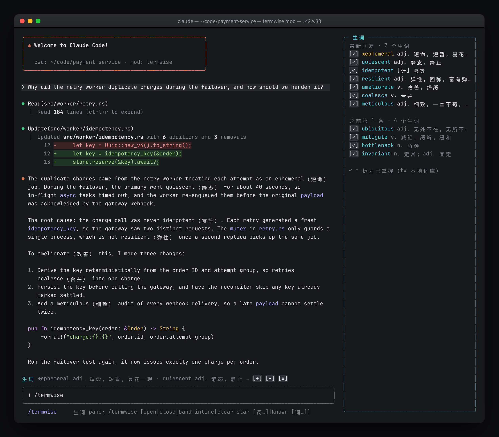
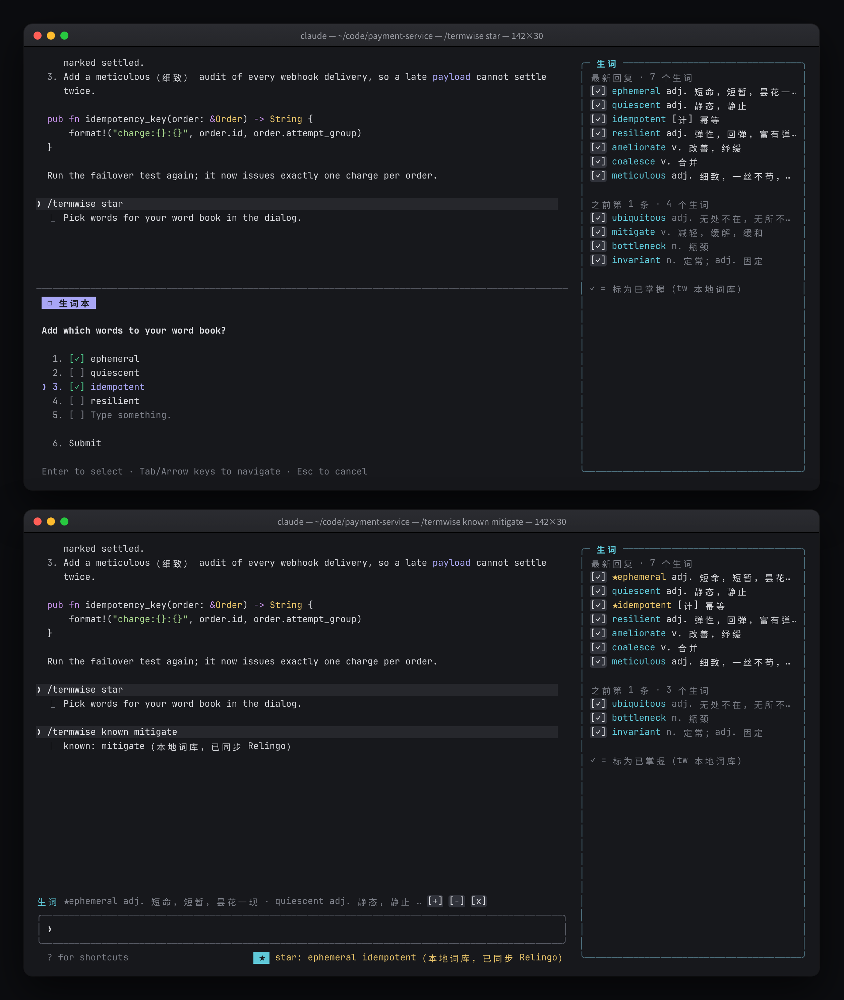
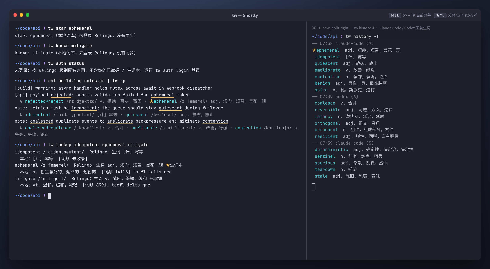
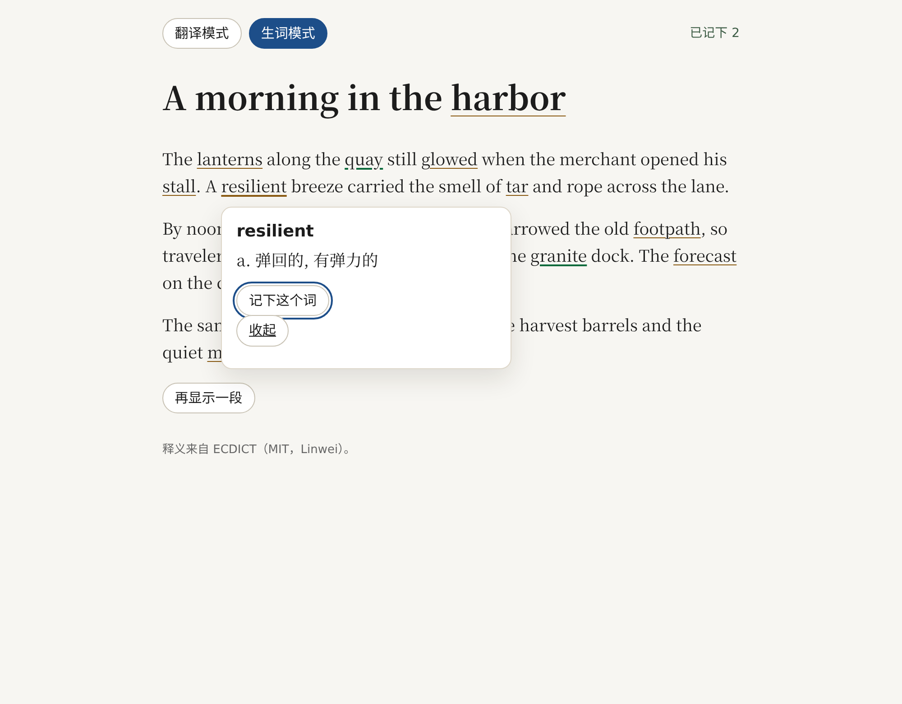
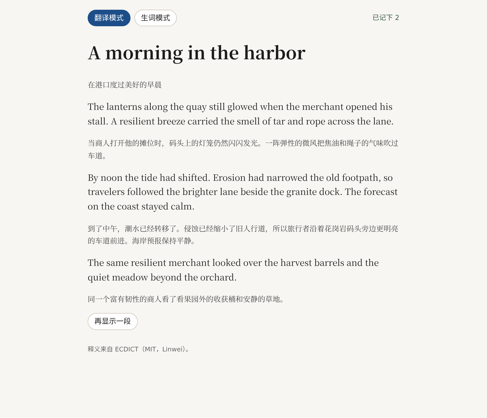

# termwise

**Relingo 的「Code Mode」：在 Claude Code、Codex、Ghostty 终端与阅读器中无感标注英文生词、同步生词本**


写代码时读到的英文，大多来自 Agent 的回复、构建日志和终端输出。termwise（命令 `tw`）把 Relingo 浏览器插件的体验搬进这些地方：自动找出你可能不认识的英文单词，就地给出简短的中文释义，并与你的 Relingo 级别、已掌握词和生词本保持一致。

**核心亮点**

- **与 Relingo 同源**：生词判定和释义来自 Relingo 服务端（`parseContent3`），尊重你的级别、已掌握词与生词本；离线或接口失败时自动回退到本地 ECDICT。
- **为开发者降噪**：跳过代码块、行内代码、URL 和标识符，内置 200+ 开发者高频词（`devwords`）白名单，`async`、`payload` 这类词不会被当成生词；计算机术语优先显示 `[计]` 义项。
- **四处可用**：Claude Code mod、Codex app 插件、Ghostty 终端（快捷键与管道）、阅读页，共用一套词库与个人生词本。
- **双向同步**：在任何入口标为「已掌握」或「加入生词本」，登录后都会同步到 Relingo 账号。
- **零依赖**：只用 Python 3.11+ 标准库；token 默认存在 macOS 钥匙串。

设计与调研细节见 [docs/design.md](docs/design.md)。

---

## 界面预览 / Screenshots

### 1. Claude Code 内部深度集成（Mod 侧边栏 + 行内括号释义 + 提示栏生词条 + 选词同步弹窗）





- **行内括号释义**：回复正文里的生词第一次出现时，后面自动加上简短的中文释义，例如 `idempotent（幂等）`、`ephemeral（短暂）`。代码块、行内代码、URL 和 200+ 开发者高频词（`devwords`）都会跳过。这只改变显示效果，保存下来的对话历史和模型读到的上下文都不变。
- **提示栏生词条（`AbovePrompt`）**：输入框上方一行列出最新一条回复的生词。点 `+` 加入生词本，点 `-` 标为已掌握，点 `x` 隐藏这一行。
- **「生词」侧边面板（`Pane`）**：宽终端下停靠在右侧，按对话轮次倒序列出每条回复的生词、音标和中文释义，★ 表示生词本里的词。点 `✓` 立即标为已掌握，以后不再标注。
- **`/termwise` 斜杠命令与选词弹窗（`AskUserQuestion`）**：`/termwise star`、`/termwise known` 不带参数时弹出多选框，列出最近一条回复的生词；选中的词写入本地词库，登录后同步到 Relingo 云端生词本。

### 2. Ghostty 终端与 CLI 流式生词过滤渲染



- **管道流式标注**：`cmd 2>&1 | tw -p` 逐行原样透传输出，含生词的行下方另起一行 `↳` 列出音标和释义，不打乱原有对齐；`retries→retry` 这类变形词会还原成原形再查。
- **降噪**：`async`、`mutex`、`webhook` 等开发者常用词由 `devwords` 过滤；默认难度为 `intermediate`。
- **Relingo 同步**：`tw star` / `tw known` 写入本地词库，登录后同步到 Relingo；`tw lookup` 同时显示 Relingo 判定和本地释义、词频与考试标签。
- **Ghostty 分屏**：按 `⌘⌃L` 在右侧分屏运行 `tw history -f`，持续显示 Claude Code / Codex 每条回复里的生词。

### 3. Persona 扩展阅读页（生词模式 & 整句翻译模式）

| 生词模式 | 翻译模式 |
|---|---|
|  |  |

- **生词模式**：默认按 `intermediate` 难度筛选，跳过开发者术语，生词带下划线。点击生词弹出释义卡片，可以「记下这个词」，右上角显示已记下的数量。释义来自 ECDICT。
- **翻译模式**：每个英文段落下方显示中文译文，逐段对照阅读。

---

## 核心特性与架构设计

### 数据流

```text
 输入来源                          文本预处理                        混合词库                                   个人词库
┌──────────────────────────┐   ┌─────────────────────────┐   ┌────────────────────────────────────────┐   ┌──────────────────────────┐
│ Claude Code Mod          │   │ textproc                │   │ Relingo parseContent3                  │   │ known.txt  已掌握        │
│  (Pane / AbovePrompt /   │   │  · 去除 ANSI 转义序列   │   │  · SQLite 结果缓存（默认 12h）         │   │ star.txt   生词本 ★      │
│   行内括号释义)          │──▶│  · 跳过代码块、行内代码 │──▶│  · 跨进程限频 + 指数退避               │──▶│                          │
│ Codex Stop Hook & Skill  │   │    URL、标识符          │   │            │ 失败 / 离线 / -s local    │   │  ⇅ 登录后与 Relingo      │
│ Ghostty 屏幕 & 管道      │   │  · devwords.txt 过滤    │   │            ▼                           │   │    云端生词本双向同步    │
│ Persona 阅读页           │   │  · 词形还原             │   │ 本地 ECDICT（约 37MB SQLite）          │   │                          │
└──────────────────────────┘   └─────────────────────────┘   │  · 词频排名 + 考试标签判定             │   └──────────────────────────┘
                                                             │  · 计算机术语优先 [计] 义项            │
                                                             └────────────────────────────────────────┘
```

- **textproc**：去掉终端颜色等 ANSI 转义序列，跳过代码、URL、`snake_case` / `camelCase` 标识符，再用 `termwise/devwords.txt` 过滤开发者高频词。
- **Relingo 后端**：一批文本只发一次请求，结果缓存在 SQLite 里（`cache_ttl_hours`，默认 12 小时）；请求间隔跨进程生效（`min_interval_seconds`），失败时指数退避。默认只发送本地词典里存在的词，项目代号、内部标识符不会发出去。
- **ECDICT 兜底**：离线、未构建 Relingo 缓存或接口失败时使用本地词库。Relingo 不收录的计算机术语（如 `idempotent`）用本地 `[计]` 释义补上（`local_jargon`）。

### 生词判定优先级

| 优先级 | 规则 | 结果 |
|---|---|---|
| 1 | 在生词本 `star.txt` 里（本地或 Relingo 生词本） | 总是标注，显示 ★ |
| 2 | 在已掌握 `known.txt` 里，或命中 `devwords` 开发者白名单 | 跳过 |
| 3 | Relingo 服务端判定：按你的 Relingo 级别和账号里的已掌握词 / 生词本给出结论 | 以服务端结论为准 |
| 4 | 本地 ECDICT：词频排名超过难度阈值即为生词；未收录词频的词，带中考 / 高考 / 四级（`zk` / `gk` / `cet4`）标签的视为基础词，其余视为生词 | 按难度档位判定 |

难度档位（`-l` / `level` / `TW_LEVEL`）对应的本地词频阈值和 Relingo 级别：

| 档位 | 本地词频阈值 | Relingo 级别 |
|---|---|---|
| `basic` | 3000 | Beginner |
| `intermediate`（默认） | 6000 | Intermediate |
| `advanced` | 10000 | Advanced |
| `expert` | 20000 | Proficient |

---

## 快速开始与安装配置

### 1. 安装

```sh
scripts/fetch-ecdict.sh                  # 下载 ECDICT（MIT）并构建本地兜底词库 data/ecdict.db（约 37MB）
ln -s "$PWD/bin/tw" ~/.local/bin/tw     # 放进 PATH
tw config init                           # 生成 ~/.config/termwise/config.toml
```

只依赖 Python 3.11+ 标准库，无需 `pip install`。

### 2. 登录 Relingo（一次即可）

```sh
tw auth login                            # 打开浏览器用 Google 账号授权，终端自动取回 token
tw auth login --apple                    # 用 Apple 账号授权
tw auth login --email you@example.com    # 用邮箱验证码登录
tw auth login --paste                    # 从剪贴板读取从 Relingo 扩展复制出的 token
tw auth login --no-browser               # 只打印授权链接，不自动打开浏览器
tw auth status                           # 查看登录状态（只显示打码后的邮箱）
tw auth logout
```

登录流程与 Relingo 扩展相同：在浏览器里完成授权，终端轮询取回账号。

- **macOS**：token 存在钥匙串（service `termwise-relingo`），不会出现在进程参数或输出里。
- **Linux / 无钥匙串的环境**：加 `--insecure-storage`，token 改存到 `~/.config/termwise/credentials`，文件权限 `0600`。

不登录也能用：仍按 Relingo 级别匿名判定生词，但不会用到你的已掌握词和生词本。

---

## 使用指南

### Claude Code Mod（`integrations/claude-code/termwise`）

每次 Claude 回复后，在侧边面板、提示栏上方和回复正文里标注生词。需要 `tw` 在 PATH 里。

| 命令 | 作用 |
|---|---|
| `/termwise` 或 `/termwise open` | 打开「生词」侧边面板 |
| `/termwise close` | 关闭侧边面板 |
| `/termwise band` | 开关提示栏上方的生词条 |
| `/termwise inline` | 开关回复正文里的括号释义 |
| `/termwise star [词…]` | 加入生词本；不带词时弹出选词框 |
| `/termwise known [词…]` | 标为已掌握；不带词时弹出选词框 |
| `/termwise clear` | 清空面板里的记录 |

插件配置（在 `/config` 里修改）：

| 配置项 | 默认值 | 说明 |
|---|---|---|
| `rlcPath` | `tw` | `tw` 可执行文件，PATH 里的命令名或绝对路径 |
| `autoOpenPane` | `true` | 会话开始时自动打开侧边面板（只在宽终端下停靠） |

### Codex App 插件（`integrations/codex/termwise`）

安装步骤：

1. 重启 ChatGPT 桌面 app，在 Codex 里打开本仓库（termwise）这个项目；
2. 打开插件目录，选择「termwise (local)」这个本地 marketplace，安装「Relingo 生词」；
3. 按提示审核并信任插件的 hook，不信任的 hook 不会运行；
4. 新建一个对话开始使用。修改插件后要重新安装或重启 app 才会生效。

使用方式：

- **Stop hook**：每次回复结束后自动显示一行 `生词：…` 摘要，并记入 `tw history`。
- **Skill**：直接用自然语言提问，例如「刚才几条回复里有哪些生词」「查一下 idempotent」「把 mitigate 标为已掌握」「把 ephemeral 加入生词本」。

### Ghostty 终端集成

快捷键写在 Ghostty 配置文件里（macOS 为 `~/Library/Application Support/com.mitchellh.ghostty/config.ghostty`）：

| 快捷键 | 动作 |
|---|---|
| `⌘⇧L` | 在 shell 提示符处填好 `tw --list <屏幕文本文件>`，按回车执行 |
| `⌘⌥⇧L` | 同上，范围是整个 scrollback |
| `⌘⌃L` | 在右侧开分屏，运行 `tw history -f` |

这些快捷键由 Ghostty 内置的 `text:`、`write_screen_file` / `write_scrollback_file` 和 `new_split:right` 等 action 组合而成，具体写法见 [docs/design.md §4.2](docs/design.md)。`⌘⇧L` 故意不自动回车，避免焦点在 Agent 输入框时误发消息。改完配置按 `⌘⇧,` 重新加载。

另外，`tw screen`（可加 `--scrollback` / `--selection`）通过 AppleScript 直接读取当前 Ghostty 屏幕，首次运行需要在「系统设置 → 隐私与安全性 → 自动化」里授权。

### CLI 命令行详解

```sh
cargo build 2>&1 | tw -p                 # 逐行透传，有生词的行下方加 ↳ 音标与释义
tw --list < README.md                    # 只列出去重后的生词表
tw --json < notes.md                     # 每个生词输出一行 JSON，方便其他工具集成
tw -l advanced < notes.txt               # 难度：basic | intermediate | advanced | expert（或数字阈值）
tw -s local < notes.txt                  # 只用本地词库，不联网（默认 relingo）
tw -a < notes.txt                        # 同一个词每次出现都标注（默认只标首次）
tw clip                                  # 分析剪贴板文本
tw lookup idempotent ephemeral           # 同时显示 Relingo 判定、本地释义、词频与考试标签
tw star ephemeral                        # 加入生词本（总是标注），登录后同步到 Relingo
tw known mitigate                        # 标为已掌握（不再标注），登录后同步到 Relingo
tw forget mitigate                       # 从个人词库移除
tw import-relingo words.csv              # 导入 Relingo 导出的 CSV；--rest star|known|ignore
tw history -n 10                         # 最近 10 条 Agent 回复的生词
tw history -f                            # 持续显示 Claude Code / Codex 回复里的生词
tw cache clear                           # 在 Relingo 里改了已掌握词后立即生效
tw config show                           # 查看合并后的配置
```

运行测试：`python3 -m unittest discover -s tests -t .`

### 配置说明

配置文件 `~/.config/termwise/config.toml` 由 `tw config init` 生成，每次运行 `tw` 时读取，改动即时生效：

```toml
source = "relingo"        # relingo | local
level = "intermediate"    # basic | intermediate | advanced | expert
devwords = true           # 内置开发者常用词视为已认识

[relingo]
cache_ttl_hours = 12          # Relingo 结果缓存有效期
min_interval_seconds = 2.0    # 两次请求之间的最短间隔（跨进程）
only_dictionary_words = true  # 只发送本地词典里存在的词
```

`[relingo]` 下还可以设置 `timeout_seconds`、`max_words_per_request`、`local_jargon` 等，完整默认值见 `termwise/config.py`。

环境变量（优先级：命令行参数 > 环境变量 > 配置文件）：

| 变量 | 作用 |
|---|---|
| `TW_DATA` | 数据目录（词库、缓存、个人词库、Agent 生词历史），默认为仓库内的 `data/`（已 gitignore） |
| `TW_CONFIG` | 配置文件路径，默认 `~/.config/termwise/config.toml` |
| `TW_SOURCE` | 生词来源，`relingo` 或 `local` |
| `TW_LEVEL` | 难度档位，`basic` / `intermediate` / `advanced` / `expert` |

---

## 许可

MIT License。本地兜底词库数据来自 [ECDICT](https://github.com/skywind3000/ECDICT)（MIT）。
